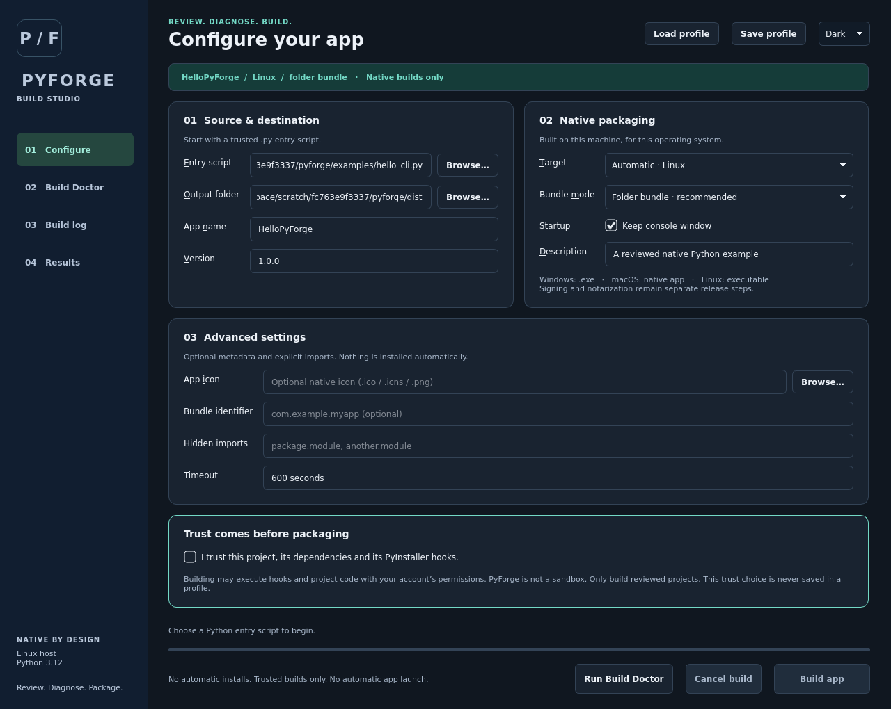
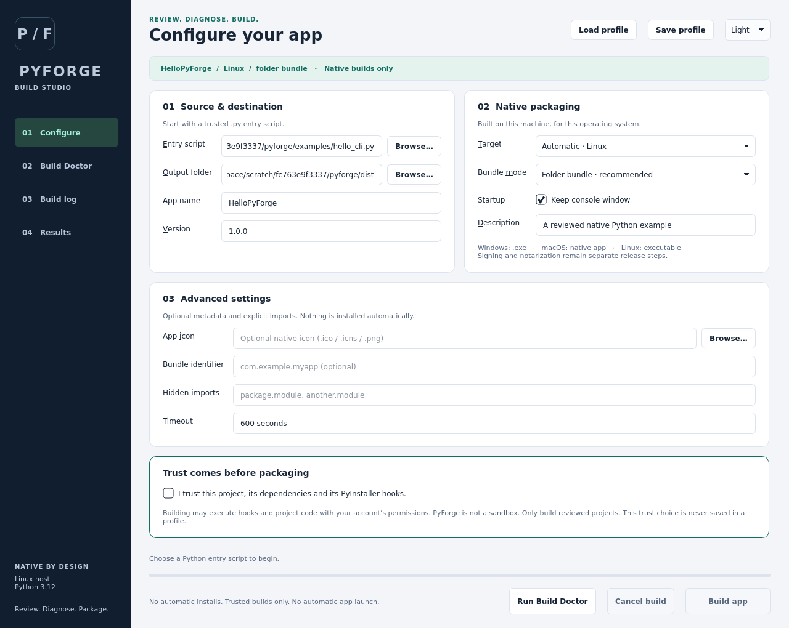

# PyForge

**Review first. Build native. Keep control.**

PyForge is a desktop application and CLI for inspecting trusted Python projects and packaging them with PyInstaller. It separates read-only inspection from code-executing builds, isolates output per run, and provides diagnostics, live logs and cancellation.

**Development candidate:** package metadata is `pyforge-tool` 0.2.0, Python 3.10+. Install from this repository; a PyPI publication and public binary release are **not established by this README**. The project license and original asset provenance still require maintainer resolution before a public release. See [licensing](docs/LICENSING.md) and the [release checklist](docs/RELEASE_CHECKLIST.md).

## Features

- Bounded static AST import inspection, without importing your project or installing packages.
- Read-only Build Doctor checks for settings, interpreter, native platform, package metadata and output location.
- Console/windowed applications, `onedir`/`onefile` modes, native icon and metadata options.
- Reusable, versioned JSON profiles containing settings, not executable commands.
- Live build events, cancellation, timeout, expected-artifact checks and structured reports.
- CLI without Qt; optional PyQt5 GUI with dark and light themes.

PyForge does **not** automatically install dependencies, overwrite `requirements.txt`, cross-compile, sign/notarize applications, or sandbox untrusted code. A frozen copy of PyForge is currently a **UI-only preview**, not a standalone build tool: packaging requires the source/venv-installed application and its Python interpreter.

## Install from source

Use an isolated virtual environment. Install only the extras you need.

```bash
git clone https://github.com/amnasahamed/pyforge.git
cd pyforge
python -m venv .venv
```

Activate on macOS/Linux:

```bash
source .venv/bin/activate
```

Or Windows PowerShell:

```powershell
.venv\Scripts\Activate.ps1
```

If activation is restricted, use `.venv\Scripts\python.exe` directly instead of changing security settings.

```bash
# CLI and native packaging
python -m pip install -e ".[build]"

# Desktop application and packaging
python -m pip install -e ".[gui,build]"

# All development components
python -m pip install -r requirements-dev.txt
python -m pip install -e ".[gui,build,dev]"
```

The base CLI has no runtime dependencies. The GUI uses PyQt5 `>=5.15.11,<6`; packaging uses PyInstaller `>=6.20,<7`. [Development setup](docs/DEVELOPMENT.md) explains reviewed tool pins and their limits.

## Quick start

These commands use the reviewed stdlib-only fixture in this repository.

```bash
pyforge --help
pyforge inspect examples/hello_cli.py
pyforge doctor examples/hello_cli.py --name Hello --output-dir dist
pyforge build examples/hello_cli.py --name Hello --output-dir dist --mode onedir --trust-code
```

`python -m pyforge` reaches the same CLI. `--trust-code` acknowledges that PyInstaller can execute project/dependency hooks. Do not use it for code you have not reviewed and do not trust. See [security](SECURITY.md).

Launch the source-installed GUI:

```bash
pyforge-gui
# Source-checkout compatibility entry point:
python pyforge.py
```

Select an entry script, review imports, run Doctor and review settings. Confirm the trusted-code warning only after reviewing the project/environment. Follow the live log or cancel; use the reported output path after a successful build.

## Native platforms, not cross-compilation

| Host | Typical output | Notes |
| --- | --- | --- |
| Windows | `.exe`, or directory containing `.exe` | Valid `.ico`; native version resources. |
| macOS | Console executable or windowed `.app` | Valid `.icns`; prefer `onedir` for `.app`; native plist metadata. |
| Linux | ELF executable or directory bundle | Not a Windows/macOS compiler. Windowed mode does not suppress a terminal in PyInstaller. Metadata/desktop sidecars are not embedded ELF version resources. |

Build on the destination OS using its Python environment. CPU architecture follows that interpreter and installed libraries; this version does not promise universal macOS or cross-architecture builds. [PyInstaller documents these constraints](https://pyinstaller.org/en/stable/operating-mode.html).

## Profiles and reports

```bash
pyforge profile save hello.pyforge.json examples/hello_cli.py --name Hello --output-dir dist
pyforge doctor --profile hello.pyforge.json --json
pyforge build --profile hello.pyforge.json --trust-code --json
```

Relative paths in hand-written profiles resolve against the profile directory; saved profiles use normalized absolute paths. Review before sharing, because paths may expose usernames and directories. `--json` emits structured CLI output. A build's reported run directory contains `dist/` and `build-report.json`; unique run directories preserve previous outputs.

Review and install project dependencies **yourself**, in the same isolated interpreter used to launch PyForge. Import names are not necessarily PyPI distribution names; dynamic imports may need reviewed `--hidden-import` options. Read [usage](docs/USAGE.md) before building a real project.

## Screenshots

Actual application captures from **Linux using Qt's offscreen platform**, not evidence of Windows/macOS desktop testing.

| Dark theme | Light theme |
| --- | --- |
|  |  |

## Validation and contributing

```bash
python -m ruff check .
python -m mypy
QT_QPA_PLATFORM=offscreen python -m pytest -m "not integration"
python -m build
```

Real packaging tests are locally opt-in because they execute reviewed code and take longer. CI is configured for Linux quality checks and native Windows/macOS packaging with example launch markers. A workflow file is not a passing run: evidence belongs in the [audit](docs/AUDIT.md) and matching GitHub Actions run.

- [Development/testing](docs/DEVELOPMENT.md), [architecture](docs/ARCHITECTURE.md), [troubleshooting](docs/TROUBLESHOOTING.md)
- [Contributing](CONTRIBUTING.md), [conduct](CODE_OF_CONDUCT.md), [security](SECURITY.md)
- [Maintainers](docs/MAINTAINER_GUIDE.md), [release checklist](docs/RELEASE_CHECKLIST.md), [roadmap](docs/ROADMAP.md)
- [Changelog](CHANGELOG.md)

## Authorship and licensing

Original project by [Amnas Ahamed](https://github.com/amnasahamed). Existing work and Git history are retained.

The baseline README claimed MIT, but no license grant text was present. This change does not invent a grant or relicense the project. PyQt is GPLv3/commercial, **not LGPL**; distribution needs a compatible licensing plan. Original `forge.*` assets remain in the checkout but are not application/build defaults. Read [LICENSING.md](docs/LICENSING.md) before redistribution.
